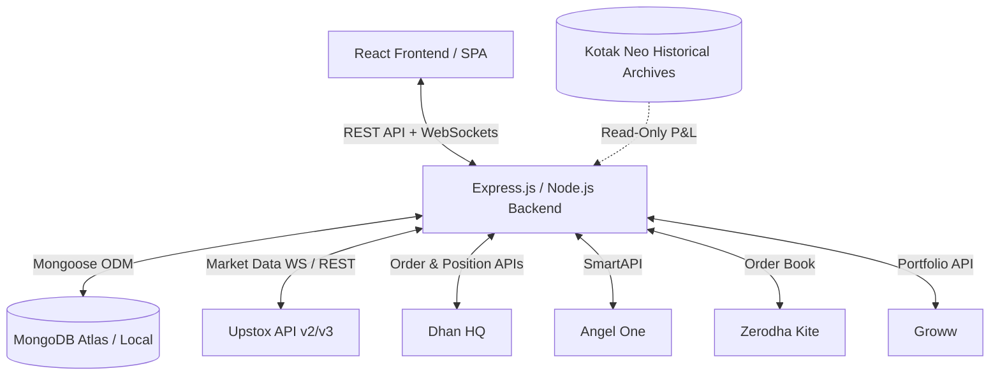

# TradeGuard 🛡️📈

> **TradeGuard** is an enterprise-grade trading journal, live portfolio analytics platform, multi-broker trade synchronization system, and automated copy-trading engine built on the MERN stack (MongoDB, Express, React, Node.js).

Designed specifically for active Indian stock and derivatives market traders, TradeGuard bridges the gap between raw broker executions, real-time portfolio tracking, disciplined trading psychology, and rigorous trade analytics.

---

## 🌟 Key Highlights & Modules

### 1. 📓 Trading Journal
A complete, institutional-grade journal tailored for discipline and self-reflection:
- **Trade-Linked & Standalone Journaling**: Log entries attached to automated broker trade records or standalone manual setups.
- **Pre-Trade Review**: Document entry reasons, setup confirmations, target, stop-loss, risk/reward, confidence levels, and trade invalidation criteria before risking capital.
- **Post-Trade Review**: Evaluate exit reasons, trading plan compliance, execution mistakes, lessons learned, and future improvements.
- **Psychology & Emotion Tracker**: Record pre-trade emotional state (*Calm, Confident, Fearful, Greedy, Distracted, etc.*) and post-trade discipline scores (1–10).
- **Mistake Tracker**: Automatically monitor and tag common pitfalls (*Revenge trading, FOMO, Overtrading, Early exit, Moving stop-loss, Excessive position size*), tracking frequency and financial loss correlation.
- **Strategy & Analytics**: Filter performance across custom strategies, win rates, profit factor, emotional states, and review periods (Weekly, Monthly, Yearly).
- **Screenshots & Attachments**: Secure multi-image uploads for entry/exit chart setups and notes with file validation.

### 2. ⚡ Multi-Broker Trade Synchronization & Order Management
Unifies trade books, order histories, and open positions across India's leading stock brokers:
- **Active Supported Brokers**:
  - **Upstox** (API v2 / v3 OAuth2 & Protobuf WebSocket)
  - **Dhan** (HQ API v2 / Data API / Position P&L)
  - **Angel One** (SmartAPI WebSocket & CSV imports)
  - **Groww** (SHA256 signature authentication & portfolio sync)
  - **Zerodha Kite Connect v3**
  - **Mock / Simulation Broker** (In-memory deterministic test & copy trading engine)
- **Legacy & Archived Support**:
  - **Kotak Neo**: Deprecated / inactive integration. Live automated order placement and new credential connection are disabled; existing historical trade records, tax P&L statements, and charges calculation plans (`KOTAK_NEO_TRADE_FREE`, `KOTAK_NEO_YOUTH`) remain fully supported.
- **Automated Sync**: Background polling and WebSocket-assisted trade book synchronization.
- **Smart Disconnect & Reconnect Protection**: Zero retry storms on expired or invalid tokens (401/403); automatically disengages streamers and isolates accounts without blocking application state.

### 3. 📊 Live Market Data & Real-Time P&L Engine
- **Protobuf & Low-Latency Streaming**: Upstox WebSocket Streamer V3 with automatic reconnect bounds and off-market detection.
- **Accurate Regulatory & Statutory Charges**: Exact calculation of Exchange Turnover Fees, SEBI turnover charges, STT/CTT, Stamp Duty, GST, and broker-specific slab/flat rates.
- **Unrealized vs Realized P&L**: Mathematical separation of open positions from closed trades, weighted average entry price handling, and partial exits.
- **Exchange Token Normalization**: Native translation across NSE, BSE, NFO, and MCX instrument keys.

### 4. 👥 Copy Trading Engine
- Institutional order distribution engine with risk validation controls.
- Circuit breaker / emergency stop kill-switch, lot size normalization, position multiplier rules, and full audit logs with credential redaction.

### 5. 🔒 Enterprise Security & Encryption
- **Credential Protection**: AES-256-GCM authenticated encryption with automatic versioning and legacy decryption support for all stored API keys, secrets, passwords, and TOTP secrets.
- **Authentication**: JWT verification, protected route middleware, and single-use password reset tokens.

---

## 🏗️ Architecture & Tech Stack



- **Frontend**: React 18, React Router v6, Lucide React, Modern CSS Design System.
- **Backend**: Node.js (ES Modules), Express.js 5, WebSockets (`ws`), Mongoose 9.
- **Testing**: Built-in `node:test` test runner for backend; Jest and React Testing Library for frontend.

---

## 📁 Repository Structure

```
TradeGuard/
├── backend/
│   ├── src/
│   │   ├── brokers/             # Broker adapters, mappers & market data streamers
│   │   │   ├── upstox/
│   │   │   ├── dhan/
│   │   │   ├── angelOne/
│   │   │   ├── kotakNeo/
│   │   │   ├── zerodha/
│   │   │   └── groww/
│   │   ├── controllers/         # API endpoints (journal, trades, broker accounts, auth)
│   │   ├── middleware/          # JWT auth, validation, file upload
│   │   ├── models/              # MongoDB Schemas (JournalEntry, TradeRecord, BrokerAccount, User)
│   │   ├── routes/              # Express API route declarations
│   │   ├── services/            # P&L Engine, MarketDataEngine, PositionEngine, BrokerSync
│   │   ├── utils/               # AES-256-GCM encryption & helper utilities
│   │   ├── app.js               # Express application configuration
│   │   └── server.js            # Server entry point & WebSocket server
│   ├── tests/                   # 90+ comprehensive backend test suites
│   ├── .env.example             # Backend environment template
│   └── package.json
│
├── frontend/
│   ├── public/                  # HTML templates & static assets
│   ├── src/
│   │   ├── __tests__/           # Frontend test suites (TradingJournal, LiveTrading, etc.)
│   │   ├── api/                 # Axios API clients & WebSocket connection handlers
│   │   ├── components/          # Reusable UI (Sidebar, Navbar, Cards, Charts, Modals)
│   │   ├── pages/               # Views: Overview, Trades, TradingJournal, Analytics, Settings
│   │   └── App.js               # Application routing & layout
│   └── package.json
│
└── README.md
```

---

## 🚀 Quick Start Guide

### Prerequisites
- **Node.js**: v18.0.0 or higher
- **npm**: v9.0.0 or higher
- **MongoDB**: Local MongoDB instance (v6.0+) or MongoDB Atlas URI

---

### 1. Backend Setup

```bash
cd backend

# Install dependencies
npm install

# Configure environment variables
cp .env.example .env # (or create .env following the reference below)

# Run database tests
npm test

# Start backend in development mode (with nodemon)
npm run dev

# Or start in production mode
npm start
```

#### Backend Environment Variables (`backend/.env`)

```env
PORT=5000
NODE_ENV=development
MONGO_URI=mongodb://localhost:27017/tradeguard
JWT_SECRET=your_super_secret_jwt_key_here
ENCRYPTION_KEY=32_byte_hex_or_base64_secret_key_for_aes256

# Optional: Uploads storage directory
UPLOAD_PATH=./uploads
```

---

### 2. Frontend Setup

```bash
cd ../frontend

# Install dependencies
npm install

# Run frontend test suite
npm test

# Start frontend development server
npm start
```
The React development server runs by default at `http://localhost:3000`.

To build the frontend for production:
```bash
npm run build
```

---

## 🧪 Testing & Verification

TradeGuard features rigorous test coverage across calculation engines, broker adapters, security encryption, and user interfaces:

### Backend Tests
```bash
npm test --prefix backend
```
- **90 passing tests** covering:
  - Regulatory charges, STT/CTT, exchange fees, and GST formulas.
  - Multi-broker trade mapping and P&L calculations (long/short, partial fills, round-trips).
  - Trading Journal schema validation, review questions, psychology, and mistake tracking.
  - Market data WebSocket resilience, post-close detection, and 401 Unauthorized abort loops.
  - AES-256-GCM encryption integrity and backward compatibility.

### Frontend Tests
```bash
CI=true npm test --prefix frontend
```
- **18 passing tests** verifying:
  - Sidebar routing and navigation (`/app/journal`, `/app/overview`, `/app/trades`).
  - Trading Journal modal interactions, tabs, and form submissions.
  - Live Trading layouts, position rendering, and credentials management.

---

## 🔒 Security & Best Practices

- **Never Commit Secrets**: Ensure `.env` files are never pushed to public repositories. Sensitive credentials in the database are encrypted at rest using AES-256-GCM.
- **Fail-Safe Polling**: Broker background synchronizers automatically halt reconnection storms if credentials expire or fail authentication.
- **Role & Ownership Isolation**: Every journal entry and broker transaction is strictly scoped to the authenticated user's ID.

---

## 📄 License

This project is proprietary and confidential. All rights reserved by TradeGuard.
